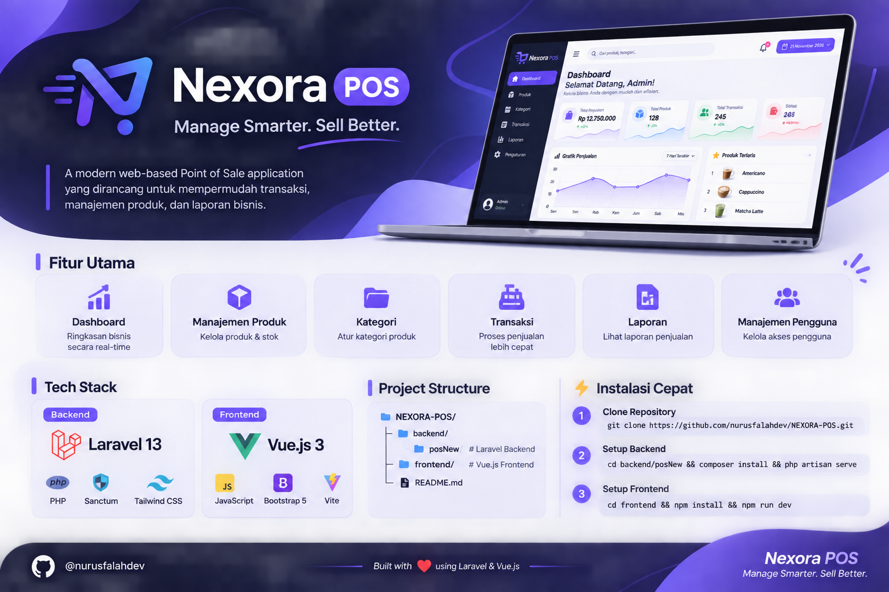

# 🚀 NEXORA POS

<div align="center">

  

  <h1>NEXORA POS</h1>

  <h3>Manage Smarter. Sell Better.</h3>

  <p>
    A modern web-based Point of Sale application designed to simplify
    sales transactions, inventory management, and business operations.
  </p>

  <br>

  
  
  
  
  

  <br><br>

  **[View Repository](https://github.com/nurusfalahdev/NEXORA-POS)**

</div>

---

## 📖 About The Project

**NEXORA POS** adalah aplikasi Point of Sale (POS) berbasis web yang dikembangkan untuk membantu bisnis dalam mengelola transaksi penjualan, inventaris produk, pengiriman barang, dan data operasional secara terintegrasi.

Dengan antarmuka modern dan sistem berbasis REST API, NEXORA POS dirancang untuk memberikan pengalaman pengelolaan bisnis yang lebih praktis, efisien, dan terstruktur.

## ✨ Key Features

| Feature | Description |
|---|---|
| 📊 Dashboard | Menampilkan ringkasan informasi dan statistik bisnis. |
| 📦 Product Management | Mengelola data produk, harga, ukuran, dan stok. |
| 🏪 Store Management | Mengelola data toko atau tujuan pengiriman. |
| 🚚 Shipping Management | Mengelola nota dan detail pengiriman barang. |
| 💰 Sales Management | Mengelola transaksi dan data barang terjual. |
| 🔍 Search & Pagination | Mempermudah pencarian dan navigasi data. |
| 🗑️ Data Management | Menambah, mengubah, dan menghapus data. |

## 🛠️ Tech Stack

### Backend
- **Laravel 13** — PHP Framework
- **PHP** — Backend Programming Language
- **MySQL** — Relational Database
- **REST API** — Backend Communication
- **Laravel Sanctum** — API Authentication

### Frontend
- **Vue.js 3** — JavaScript Framework
- **JavaScript** — Programming Language
- **Bootstrap 6** — CSS Framework
- **Vite** — Frontend Build Tool
- **SweetAlert2** — Interactive Notifications

## 📁 Project Structure

```text
NEXORA-POS/
│
├── backend/
│   └── posNew/
│       ├── app/
│       ├── database/
│       ├── routes/
│       └── ...
│
├── frontend/
│   ├── public/
│   │   └── logo.png
│   ├── src/
│   ├── package.json
│   └── ...
│
├── .gitignore
└── README.md
```

## ⚙️ Installation & Setup

### 1. Clone Repository

```bash
git clone https://github.com/nurusfalahdev/NEXORA-POS.git

cd NEXORA-POS
```

### 2. Setup Backend

Masuk ke direktori Laravel:

```bash
cd backend/posNew
```

Install dependencies:

```bash
composer install
```

Buat file environment:

```bash
cp .env.example .env
```

Generate application key:

```bash
php artisan key:generate
```

Atur konfigurasi database pada file `.env`:

```env
DB_CONNECTION=mysql
DB_HOST=127.0.0.1
DB_PORT=3306
DB_DATABASE=nexora_pos
DB_USERNAME=root
DB_PASSWORD=
```

Jalankan migrasi database:

```bash
php artisan migrate
```

Jalankan backend:

```bash
php artisan serve
```

### 3. Setup Frontend

Buka terminal baru, kemudian masuk ke direktori frontend:

```bash
cd frontend
```

Install dependencies:

```bash
npm install
```

Jalankan development server:

```bash
npm run dev
```

## 🌐 Development Environment

| Component | Address |
|---|---|
| Laravel Backend | `http://127.0.0.1:8000` |
| Vue.js Frontend | `http://localhost:5173` |
| Database | MySQL |

## 🚧 Development Status

NEXORA POS is currently under active development.

Beberapa fitur dan komponen aplikasi masih terus dikembangkan dan disempurnakan untuk meningkatkan fungsionalitas serta pengalaman pengguna.

## 👨‍💻 Developer

<div align="center">

  <h3>Nurus Falah Aditya Hidayat</h3>

  **Information Systems Student**  
  Universitas Terbuka

  <a href="https://github.com/nurusfalahdev">
    
  </a>

</div>

---

<div align="center">

  **NEXORA POS**

  *Manage Smarter. Sell Better.*

  Built with ❤️ using Laravel & Vue.js

</div>